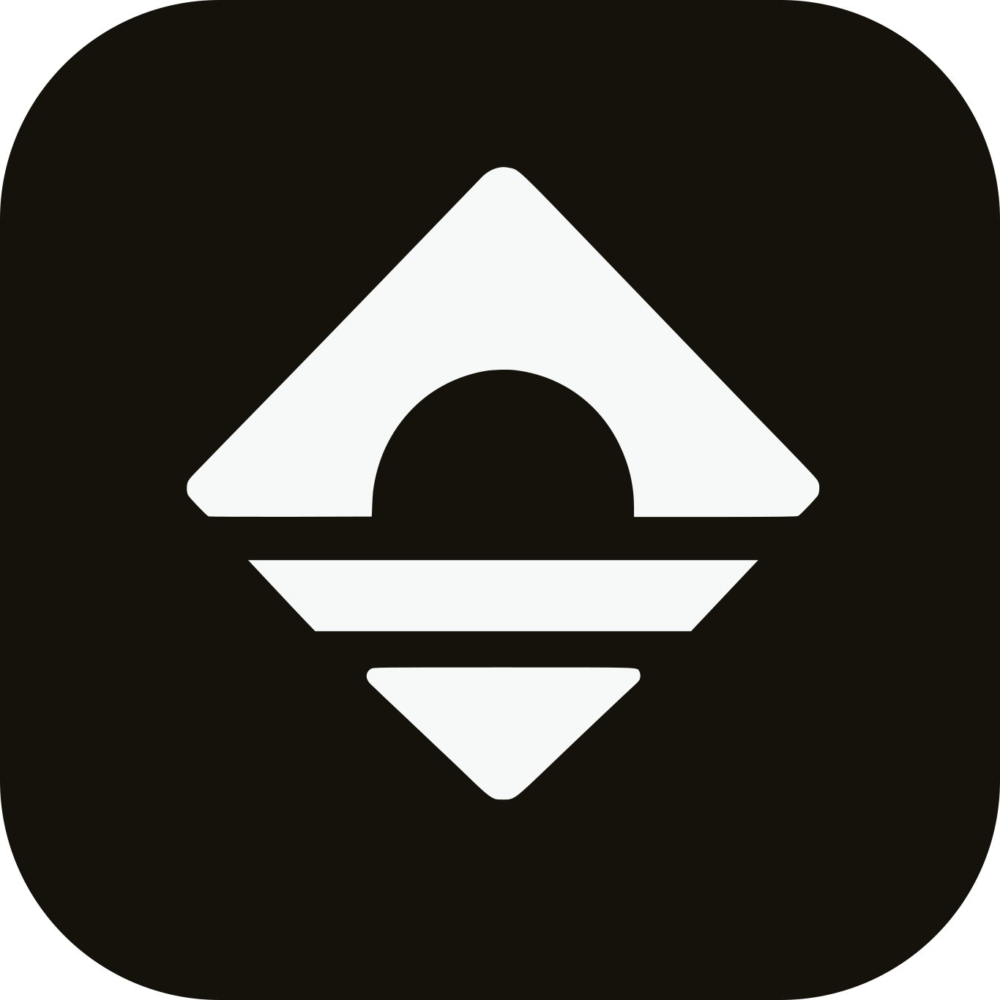
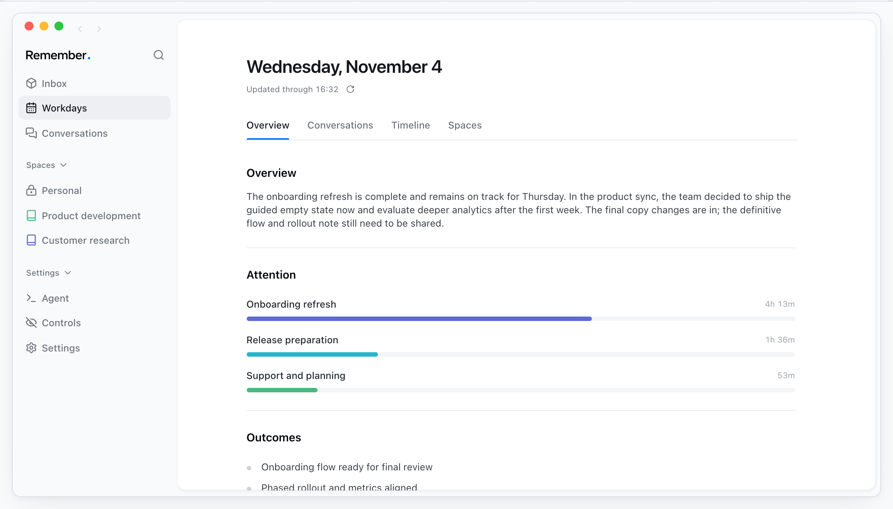

<p align="center">
  
</p>

<h1 align="center">Remember</h1>
<h3 align="center">The system for work that remembers</h3>

<p align="center">
  Remember turns your work into a living memory you can always return to.
</p>

<p align="center">
  <a href="https://www.remember.computer">Website</a> ·
  <a href="https://github.com/janrtvld/remember/releases/latest">Download for Mac</a> ·
  <a href="#development">Build from source</a> ·
  <a href="https://github.com/janrtvld/remember/issues">Report a bug</a>
</p>

<p align="center">
  <a href="LICENSE"></a>
  
  
</p>



<p align="center"><sub>Product preview with sample data. <a href="https://www.remember.computer/#product-preview">Try the interactive demo →</a></sub></p>

Remember is a free, open-source macOS app that keeps track of your work, conversations, and decisions. It captures context on your Mac, transcribes audio locally, and gives you and your AI tools a memory to work from.

No Remember account. No backend to run. Your recordings, work history, and Spaces live on your Mac.

## What you can do

- **Remember what was discussed.** Record microphone and system audio, transcribe locally, and return to the original conversation when you need the details.
- **Pick up where you left off.** Revisit your day, decisions, and outstanding work with links back to the context.
- **Build knowledge as you work.** Keep useful knowledge in your Personal Space. Create additional local Spaces for projects or topics when you need them.
- **Ask about your work.** Use the Remember agent to find conversations, explain decisions, and help you continue.
- **Give your AI tools context.** Connect Codex or Claude so they can retrieve saved knowledge and maintain your long-term memory across sessions.
- **Stay in control.** Pause capture, exclude apps, and use Offline mode. Local recording and transcription keep working after model setup.

Spaces are long-term memory for you and your agents. Each contains local documents that you can read and edit, with source references and revision history. Everything starts in Personal; organizing more Spaces is optional.

## Get started

Remember is in beta and supports **macOS 14.4 or newer on Apple Silicon (M1 or newer)**.

1. [Download Remember](https://github.com/janrtvld/remember/releases/latest) and move it to Applications.
2. Open the app, grant the capture permissions you want to use, and install the local transcription model.
3. Optionally connect your own ChatGPT or Claude account for AI analysis and assistance.
4. Record a conversation or let Remember capture work context, then revisit your day and saved knowledge.

Remember is free. AI providers use your own subscription or credits; their availability and terms apply.

## Local data, optional AI

Remember stores audio, transcripts, activity, day summaries, and Spaces in its local app data directory. Audio transcription uses **Parakeet V3** on your Mac. There is no Remember cloud account, hosted Space, or invitation system.

AI analysis is optional and requires an internet connection. Relevant transcript text and captured screen context are sent to the ChatGPT or Claude connection you select; local storage does not mean those AI requests stay on-device. Raw audio is not sent to these agents.

The app also connects to GitHub for updates and model installation, and sends sanitized technical error reports to Sentry. You can turn off **Technical error reports** independently in Settings; the preference is stored locally and is on by default. The optional Revinote integration uploads recordings only when you choose its processing workflow. Offline mode pauses all external connections, including error reports, without changing that preference. Local features remain available. See the [privacy policy](https://www.remember.computer/privacy) for details.

## Development

Requirements:

- macOS 14.4 or newer on Apple Silicon
- Xcode 26 or newer with the macOS 26 SDK, selected as your active developer directory
- Node.js **26.13.0**, pinned in [`.node-version`](.node-version)
- pnpm **12.16.1**, pinned in [`package.json`](package.json)

```bash
git clone https://github.com/janrtvld/remember.git
cd remember
pnpm install
pnpm dev:desktop
```

The desktop command builds the native helpers and starts Electron with the Next.js renderer. No Google credentials, cloud database, or server deployment is required.

For interface development, run `pnpm dev` and open [localhost:3000](http://localhost:3000). It uses the real renderer with a development-only bridge and sample data. This preview does not capture your Mac or exercise Electron integration.

| Command | Purpose |
| --- | --- |
| `pnpm dev` | Renderer with local sample data |
| `pnpm dev:desktop` | Native desktop development |
| `pnpm dev:site` | Landing page at localhost:3001 |
| `pnpm validate` | Formatting, lint, types, and tests |
| `pnpm build` | Build the renderer and desktop app |
| `pnpm qa:electron` | Native verification with an isolated app profile |

### Repository layout

| Path | Contents |
| --- | --- |
| `apps/desktop` | Electron app, native macOS capture, local storage, and agent integrations |
| `apps/web` | Next.js application interface |
| `apps/site` | Public website and interactive product preview |
| `packages/shared` | Shared types and app contracts |

See [native verification](docs/native-verification.md) for native checks and [CI and releases](docs/ci-and-releases.md) for distribution. Signed, notarized distribution builds require your own Apple signing credentials; normal development does not.

<details>
<summary>Alternative Claude analysis endpoint</summary>

Day analysis can use an opt-in Anthropic-compatible HTTPS endpoint. Quit Remember, copy [`config/claude-analysis.json.example`](config/claude-analysis.json.example) to `~/Library/Application Support/Remember/claude-analysis.json`, set both values, and restrict the file to your user with `chmod 600`.

This applies only to Claude-based Day analysis. It does not change Claude login, Codex, or other app requests. Restart Remember after editing, and keep the file out of version control.

</details>

## Contributing

Bug reports, focused fixes, and improvements to the everyday experience are welcome. Open an [issue](https://github.com/janrtvld/remember/issues) with the steps to reproduce, expected behavior, and app/macOS versions. Use sample data in screenshots and reports.

For a code change, read [AGENTS.md](AGENTS.md), run `pnpm validate`, and exercise the affected flow in the app. Renderer checks are useful for interface changes; capture, permissions, IPC, and persistence need native verification. Describe what changed and how you verified it in your pull request.

## License

Remember's source code is available under the [MIT license](LICENSE). Third-party dependencies, fonts, model files, and provider runtimes retain their own licenses and terms; see [THIRD_PARTY_NOTICES.md](THIRD_PARTY_NOTICES.md).
