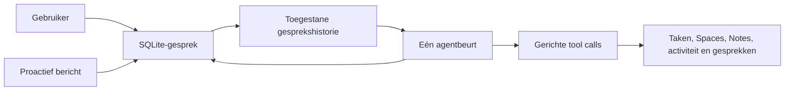

# Eén doorlopend Remember-gesprek

Implementatie en lokale verificatie: 4 november 2026.

De Agent gebruikt één opgeslagen gesprek. Gebruikersberichten, proactieve berichten en gewone antwoorden staan in dezelfde SQLite-historie. Een reactie op een initiatief krijgt dat initiatief direct als context; de agent hoeft niet eerst via een aparte tool te ontdekken wat hij zelf net heeft gezegd.

## Eigenaarschap

`residentAgentService` bezit de beurt, Stop, herstart en publicatie. `residentConversationContext` maakt de gesprekshistorie en levert `remember_chat` voor oudere berichten. `residentTurnTools` verbindt dezelfde bron- en schrijftools voor beide providers met één register van werkelijk gelezen gegevens. `residentAgentRuntime` verbindt deze onderdelen met Electron en de bestaande opslag.

De normale chat heeft geen alternatieve route zonder tools meer. Er is geen automatische volledige Space-, dag- of archiefopvraag aan het begin van iedere beurt. De agent krijgt datum, tijdzone en recente chat en kiest zelf de benodigde tools. Een gewone bevestiging kan zonder tool call worden beantwoord.

Het logische gesprek is duurzaam; de provideruitvoering wordt per beurt opgebouwd uit de toegestane historie. Een oude providerthread wordt lokaal niet hervat. Daardoor bestaat er geen tweede, voor Remember onfilterbare context die eerder ingetrokken broninhoud opnieuw aan het model kan geven. Stop en bestaande herstelprotocollen blijven hun eigen uitvoeringsidentiteit behouden.

## Context en wijzigingen

Recente context bevat maximaal veertig berichten binnen 24.000 geserialiseerde tekens. Lange berichten zijn gemarkeerd als ingekort; `remember_chat` kan oudere pagina's en verdere tekst ophalen. Paginering gebruikt SQLite-volgorde. Een retry van een oudere vraag behoudt latere gebruikerscorrecties.

Beschermde berichten behouden hun exacte bronafhankelijkheden. Die worden vóór blootstelling atomisch aan het nieuwe antwoord gekoppeld. Ingetrokken bronnen en afgeleide antwoorden worden weggelaten; intrekking tijdens een beurt blokkeert ook late uitvoer. Context en bronafhankelijkheden blijven begrensd. Dit kan oudere beschermde berichten uit de directe context houden; de tool meldt ontbrekende context in plaats van die te reconstrueren.

Taken en Spaces blijven de bestaande canonieke opslag gebruiken. De tools behouden revisiecontrole, beoordeling, idempotente receipts en Auto/Suggest-beleid. De agent kan beschikbare Spaces ontdekken zonder dat elke vervolgzin de Space-naam moet herhalen. De toolbeschrijving noemt de vereiste schrijfvelden expliciet.

Alleen werkelijk gebruikte bronnen worden vóór publicatie opnieuw gecontroleerd. Een goedgekeurde wijziging ververst alleen de bijbehorende leesregistraties. Taken gebruiken daarvoor dezelfde canonieke taakprojectie, inclusief feiten en eigenaarschapsmetadata. Een gelijktijdige wijziging aan een andere taak of pagina wordt niet door deze verversing goedgekeurd.

Gesprekken worden met één archieftool opgehaald. De agent formuleert vervolgens zelf het antwoord. Het oude verplichte `remember_answer`-publicatieprotocol is uit de actieve route gehaald. Datums, records, paginering, complete dekking en bronversies worden nog steeds gecontroleerd. De inhoudelijke synthese ligt bij het model; bronversiecontrole bewijst niet dat iedere parafrase juist is.

## Bewijs

- Het ingestelde echte model beantwoordde “Mitchel is picking that up” met “Mitchel is handling the store publication follow-up”, ook na heropenen van de chatstore. Beide beurten gebruikten nul tool calls.
- Dezelfde live proef gebruikte de gedeelde toolafhandeling om een synthetische taak af te vinken, een synthetische Space-pagina te wijzigen en een opgeslagen testgesprek samen te vatten. De taakbevestiging en de Space-bevestiging doorstonden de broncontrole.
- 445 agenttests en 18 gerichte renderertests slaagden; lint en desktop-/webtypes waren groen. Na de laatste transactie- en contextselectiecontrole slaagden ook 47 gerichte opslag-/contexttests.
- De native Electron-proef controleerde chat, streaming, navigatie, Stop, retry, beoordeling, smalle vensters, toestemming en volledige herstart met een deterministische provider. Het gegenereerde rapport is gelezen en geslaagd.
- De browsercontrole toonde de nieuwe tijdnotatie bij normale en 390px breedte. Vandaag toont alleen de tijd, bijvoorbeeld `2:29 PM`; gisteren behoudt zijn datumlabel.

Live bewijs: `.qa/continuing-agent-2026-11-04/live-model-proof.json`. Native rapport: `/private/tmp/remember-continuing-agent/runs/2026-11-04T15-43-26.709Z/report.json`. De live proef is herhaalbaar met `node --import tsx scripts/qa/continuingAgentLive.ts` vanuit `apps/desktop`; deze doet echte modelcalls, uitsluitend over synthetische gegevens en geïsoleerde stores.

De wijzigingen zijn lokaal. Er is geen geïnstalleerde app vervangen, release gepubliceerd of nieuw autonoom subagentsysteem toegevoegd. De oudere experimentele host-/briefingharnassen die een route zonder tools simuleren, zijn geen bewijs voor deze actieve architectuur. De native fixtureproef bewijst geen echte capturekwaliteit; de live modelproef bewijst geen langdurige kwaliteit op het persoonlijke archief.
